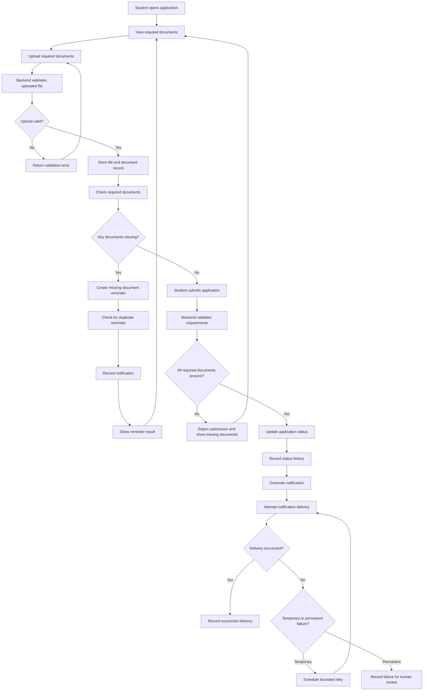

      # Week 13 – Automation Workflow Diagram

This diagram shows the bounded scholarship application workflow, including document checking, submission, reminder generation, and notification delivery.

