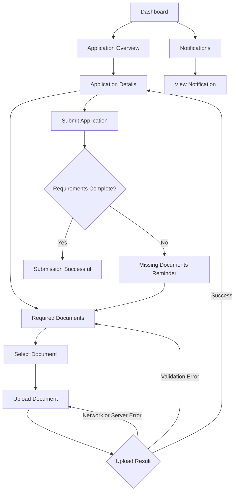

# Week 13 – Flutter Web Screen Flow

## 1. Purpose

This document describes the planned screen flow and user interface states for the Scholarship Requirement Tracker. It focuses on the Week 13 automation workflow, including document submission, missing-document reminders, deadline alerts, reviewer assignment, and application status notifications.

## 2. Screen Flow

## 3. Main Screens

| Screen | Purpose |
|---|---|
| Dashboard | Displays application summaries, required documents, and recent notifications. |
| Application Overview | Provides access to the student's application. |
| Application Details | Displays application information, status, and document checklist. |
| Required Documents | Shows which requirements are submitted or missing. |
| Document Upload | Allows the student to select and upload a required document. |
| Notifications | Displays reminders, deadline alerts, and application status updates. |

## 4. Required UI States

| UI State | Expected Behavior |
|---|---|
| Loading | Displays a progress indicator while waiting for an API response. |
| Success | Displays confirmation when an operation completes successfully. |
| Empty | Shows a helpful message when no notifications or records are available. |
| Validation Error | Explains missing or invalid information and allows correction. |
| Authorization Error | Displays a safe message when access is not permitted. |
| Network Error | Informs the user that the server cannot be reached and allows another attempt. |
| Server Error | Displays a general failure message without exposing technical details. |

## 5. Automation-Related Interface Behavior

- Missing required documents should be clearly identified.
- Successful document uploads should update the document checklist.
- Incomplete applications should not be submitted.
- Successful submission should display a confirmation.
- Notifications should communicate relevant application reminders and status updates.
- Notification messages must not expose confidential reviewer comments or internal decisions.
- Failed operations should provide understandable feedback and an appropriate recovery action.

## 6. Scope and Limitations

This screen flow represents the Week 13 automation scope. It does not include the implementation of additional security features or integrations assigned to later weeks.

The screen flow is a design reference. Actual behavior must be verified through implementation and testing.

## 7. Expected Outcome

The Flutter Web interface should provide a clear path from the dashboard to application details, document upload, submission, and notification viewing. It should also communicate loading, success, empty, and failure states appropriately.
