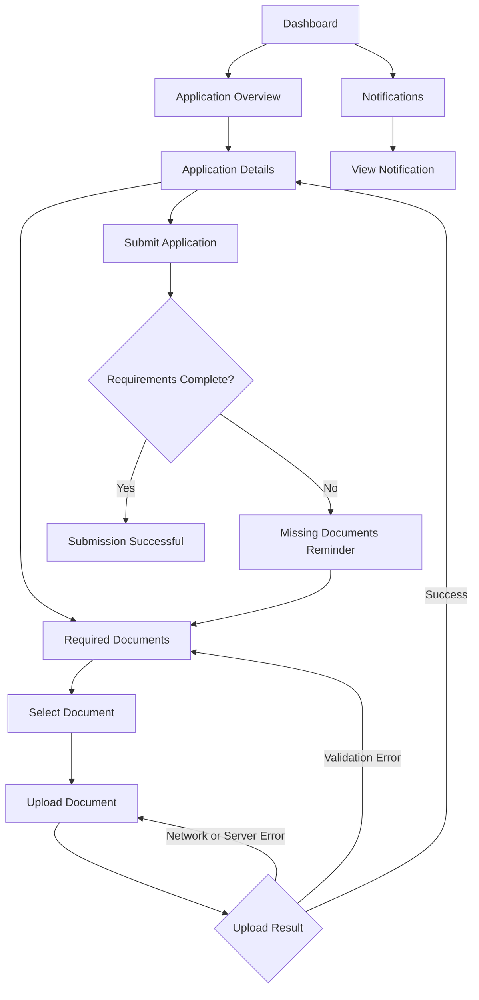

# Week 13 – Flutter Web Screen Flow

## 1. Purpose

This document describes the planned screen flow and user interface states for the Scholarship Requirement Tracker. It focuses on the Week 13 automation workflow, including document submission, missing-document reminders, deadline alerts, reviewer assignment, and application status notifications.

## 2. Screen Flow

## 3. Main Screens

| Screen | Purpose |
|---|---|
| Dashboard | Displays application summaries, required documents, and recent notifications. |
| Application Overview | Provides access to the student's application. |
| Application Details | Displays application information, status, and document checklist. |
| Required Documents | Shows which requirements are submitted or missing. |
| Document Upload | Allows the student to select and upload a required document. |
| Notifications | Displays reminders, deadline alerts, and application status updates. |

## 4. Required UI States

| UI State | Expected Behavior |
|---|---|
| Loading | Displays a progress indicator while waiting for an API response. |
| Success | Displays confirmation when an operation completes successfully. |
| Empty | Shows a helpful message when no notifications or records are available. |
| Validation Error | Explains missing or invalid information and allows correction. |
| Authorization Error | Displays a safe message when access is not permitted. |
| Network Error | Informs the user that the server cannot be reached and allows another attempt. |
| Server Error | Displays a general failure message without exposing technical details. |

## 5. Automation-Related Interface Behavior

- Missing required documents should be clearly identified.
- Successful document uploads should update the document checklist.
- Incomplete applications should not be submitted.
- Successful submission should display a confirmation.
- Notifications should communicate relevant application reminders and status updates.
- Notification messages must not expose confidential reviewer comments or internal decisions.
- Failed operations should provide understandable feedback and an appropriate recovery action.

## 6. Scope and Limitations

Scope of the Project
The Scholarship Requirement Tracker is a web-based application designed to help students monitor their scholarship applications, track required documents, and receive notifications about missing requirements and approaching deadlines.

The system includes the following functions:
1. User Account Management – Allows students and authorized staff to access the system according to their assigned roles.
2. Scholarship Management – Allows authorized staff to manage scholarship programs, requirements, and application deadlines.
3. Document Submission – Allows students to upload and manage the documents required for their scholarship applications.
4. Requirement Tracking – Displays submitted, missing, and incomplete documents.
5. Application Monitoring – Allows students to monitor their application status.
6. Automated Notifications – Generates reminders for missing documents, approaching deadlines, reviewer assignments, and application status changes.
7. Application Validation – Checks whether all required documents are complete before allowing an application to be submitted.
8. Application Review – Supports reviewer assignment and application status updates by authorized staff.

Out of Scope of the Project
The following functions are excluded from the current development of the Scholarship Requirement Tracker:
1. Scholarship Payment Processing – The system will not process scholarship allowances, tuition payments, or financial transactions.
2. Automatic Scholarship Approval – The system will not automatically approve or reject scholarship applications. Final decisions remain with authorized personnel.
3. External Institution Integration – The system will not automatically retrieve student records from university databases or external institutions.
4. Third-Party Scholarship Applications – The system will not submit applications to external scholarship organizations or government portals.
5. Physical Document Processing – The system will not handle the physical printing, notarization, or delivery of original documents.
6. SMS Notifications – The system will not send reminders through SMS. Notifications will use the supported in-app and email channels.
7. Native Mobile Application – The project focuses on a web-based application rather than separate Android or iOS applications.

## 7. Expected Outcome

The Flutter Web interface should provide a clear path from the dashboard to application details, document upload, submission, and notification viewing. It should also communicate loading, success, empty, and failure states appropriately.
