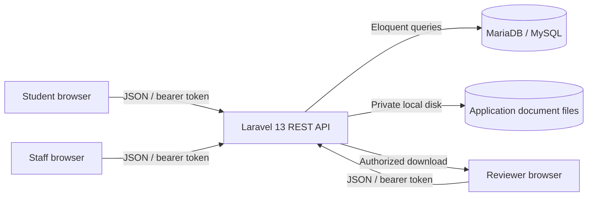

# Architecture and Decisions

## System shape

The browser client is Flutter Web. The server exposes Laravel API operations. Sanctum personal access tokens authenticate protected routes. MySQL/MariaDB holds users and roles, programs, applications, document definitions and metadata, assignments, status history, and notifications. Uploaded files use the Laravel local disk and are downloaded only through a controller that checks role and, for reviewers, active assignment.

## Core data relationships

- A user has a role; a student owns applications.
- A scholarship program has required-document definitions and many applications.
- An application belongs to one student and one scholarship program.
- An application has uploaded-document metadata and a status-history trail.
- Review assignments link an application with a reviewer and assignment state.
- Notifications belong to a user and may reference an application.

## Decision record

**Selected:** Flutter Web + Laravel API + MariaDB/MySQL.
**Alternatives considered:** Laravel-rendered frontend; Flutter Web with a different backend.
**Reason:** Reuse working code, existing tests, and the current API boundary; no measured requirement justifies a rewrite.
**Evidence basis:** qualitative comparison, not a performance or cost benchmark.
**Decision boundary:** appropriate for this academic prototype only.

## Interface and state handling

The frontend uses a local API base URL, JSON requests, multipart uploads, and bearer authorization. The backend validates roles, ownership, program availability, file type/size, document requirements, and status paths. Loading/success/empty/error states exist for the reviewed flows; outage recovery and storage errors have recorded UAT evidence.

## Security decisions and boundaries

Passwords are stored through Laravel `Hash::make`; bearer tokens are issued by Sanctum and deleted on logout. Protected API operations enforce role, ownership, and assignment rules. Document files use a private local storage path and authorized download endpoint. The checked-in client targets localhost for development. Production HTTPS, managed secrets, database/file-storage encryption at rest, private durable object storage, CORS rules, backup restore, monitoring, and security review must be designed and verified before deployment.
